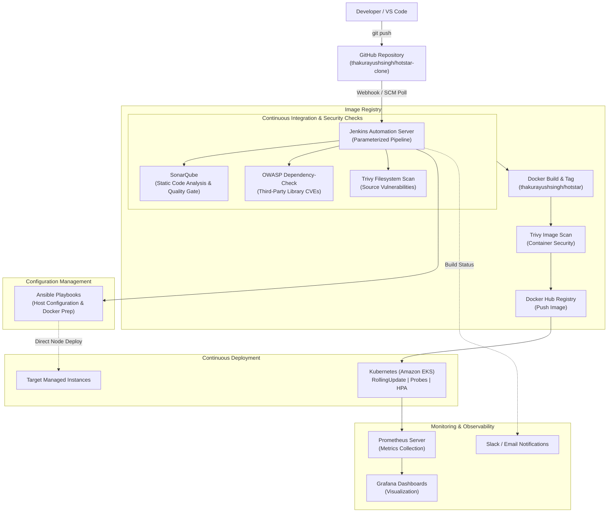

# Disney+ Hotstar Clone: End-to-End DevSecOps Deployment

> **Course**: INT 333 - DEVOPS ADVANCE CONFIGURATION MANAGEMENT  
> **Institution**: Lovely Professional University  
> **Student Name**: Ram Singh Yadav  
> **Registration Number**: 12307974 | **Roll No**: 10 | **Section**: K2O  
> **Repository**: [https://github.com/thakurayushsingh/hotstar-clone.git](https://github.com/thakurayushsingh/hotstar-clone.git)

---

## 📌 1. Project Overview & Objectives
This project demonstrates an end-to-end, enterprise-grade DevSecOps pipeline for building, securing, containerizing, and orchestrating a **Disney+ Hotstar Clone** video streaming web application using **Jenkins**, **Ansible**, **Docker**, **Kubernetes (Amazon EKS)**, **SonarQube**, **Trivy**, **OWASP Dependency-Check**, and **Prometheus/Grafana**.

### Core Objectives:
1. **Automated CI/CD Pipeline**: Parameterized Jenkins pipeline automating source-code checkout, code-quality checks, dependency vulnerability scanning, container packaging, and deployment across environments (`dev`, `staging`, `prod`).
2. **Containerization & Orchestration**: Docker-packaged lightweight container images orchestrated on Kubernetes with automated rolling updates, health probes, resource limits, and Horizontal Pod Autoscaling (HPA).
3. **DevSecOps Integration**: Shift-left security using **SonarQube** (code quality & bugs), **OWASP Dependency-Check** (third-party CVEs), and **Trivy** (filesystem and container image vulnerability scans).
4. **Configuration Management**: Agentless automation using **Ansible Playbooks** to manage managed nodes, install Docker, verify service states, and orchestrate containerized deployments.
5. **Observability & Alerting**: Real-time infrastructure and application metric collection using **Prometheus** and visualization using **Grafana**, alongside pipeline alerts.

---

## 🏗️ 2. DevSecOps Architecture



---

## 🛠️ 3. Tools & Technologies Matrix

| Category | Tool | Purpose in Project |
|---|---|---|
| **Version Control** | Git & GitHub | Source code tracking and pipeline integration |
| **CI/CD Automation** | Jenkins (Declarative Pipeline) | Multi-stage parameterized build, test, and release orchestration |
| **Code Quality** | SonarQube | Static code analysis, test coverage, and Quality Gate verification |
| **Dependency Security** | OWASP Dependency-Check | Identification of known CVEs in npm dependencies |
| **Container Security** | Trivy | Vulnerability scanning for source code filesystem and Docker images |
| **Containerization** | Docker | Creating portable, reproducible application images |
| **Orchestration** | Kubernetes (EKS) | Pod management, service discovery, rolling deployments, and HPA |
| **Configuration Mgmt** | Ansible | Repeatable automated configuration of Docker and deployment nodes |
| **Infrastructure as Code** | Terraform & AWS EKS | Declarative provisioning of AWS cloud compute and networking |
| **Monitoring** | Prometheus & Grafana | Metrics collection, threshold alerts, and dashboard analytics |
| **Notifications** | Slack / Email | Pipeline execution and deployment health notifications |

---

## ⚙️ 4. Repository Structure

```text
hotstar-kubernetes-main/
├── Jenkinsfile                          # Unified Master Parameterized Pipeline
├── Dockerfile                           # Production Docker container definition
├── package.json                         # React project dependencies & scripts
├── K8S/
│   ├── Jenkinsfile                      # Dedicated Kubernetes CI/CD Pipeline
│   ├── manifest.yml                     # Deployment, Service (LoadBalancer) & HPA
│   └── eks-cluster-and-Deployment-guide.txt # EKS cluster provisioning manual
├── ansible/
│   ├── ansible.cfg                      # Ansible configuration file
│   ├── inventory.ini                    # Managed hosts inventory
│   └── playbooks/
│       ├── setup-docker.yml             # Automates Docker installation & group config
│       ├── deploy-app.yml               # Deploys Hotstar container on target nodes
│       └── site.yml                     # Master execution playbook
├── monitoring/
│   ├── prometheus.yml                   # Prometheus scrape configurations
│   ├── alert_rules.yml                  # Prometheus metric alerts
│   └── k8s-prometheus.yml               # Kubernetes Prometheus Deployment & Service
├── Terraform/
│   ├── main.tf                          # AWS EC2 & Security Group definitions
│   ├── variables.tf                     # Configurable AWS variables
│   ├── output.tf                        # Public IP outputs
│   └── jenkinsfile                      # Terraform automation pipeline
└── scripts/                             # Host bootstrap & prerequisite scripts
    ├── docker.sh
    ├── jenkins.sh
    ├── kubectl.sh
    ├── eksctl.sh
    ├── awscli.sh
    ├── trivy.sh
    ├── terraform.sh
    └── grafana.sh
```

---

## 🚀 5. Step-by-Step Execution & Deployment Guide

### Phase 1: Push Code to Your GitHub Repository
From the project root:
```bash
git init
git branch -M main
git remote add origin https://github.com/thakurayushsingh/hotstar-clone.git
git add .
git commit -m "feat: complete INT 333 DevSecOps, Ansible, and K8s configuration"
git push -u origin main
```

---

### Phase 2: Host Bootstrap & Tool Installation
On an **Ubuntu 22.04 LTS** EC2 instance (`t2.large`, 30 GB EBS recommended):
```bash
git clone https://github.com/thakurayushsingh/hotstar-clone.git
cd hotstar-clone/scripts
chmod +x *.sh

# Execute tool installation scripts
./jenkins.sh
./docker.sh
./awscli.sh
./kubectl.sh
./eksctl.sh
./trivy.sh
sudo apt-get install -y ansible

# Run SonarQube container
docker run -d --name sonar -p 9000:9000 sonarqube:lts-community
```

---

### Phase 3: Jenkins Credentials & Global Tools Setup
Open Jenkins at `http://<EC2-IP>:8080`:

1. **Install Plugins**:
   - `NodeJS Plugin`
   - `Eclipse Temurin Installer` (JDK)
   - `SonarQube Scanner`
   - `OWASP Dependency-Check Plugin`
   - `Docker Pipeline`
   - `Ansible Plugin`
   - `Slack Notification Plugin` *(Optional)*

2. **Configure Tools** (`Manage Jenkins` → `Tools`):
   - **JDK**: Name: `jdk-17`
   - **NodeJS**: Name: `Node16`
   - **SonarQube Scanner**: Name: `sonar-scanner`
   - **Dependency-Check**: Name: `DP`

3. **Configure Credentials** (`Manage Jenkins` → `Credentials`):
   - `docker`: Docker Hub Username (`thakurayushsingh`) and Password/Token.
   - `Sonar-token`: Secret text token generated in SonarQube (`Administration` → `Security` → `Users` → `Tokens`).
   - `sonar-server`: System-level SonarQube server (`Manage Jenkins` → `System` → URL: `http://<EC2-IP>:9000`).

---

### Phase 4: Create Amazon EKS Cluster
```bash
aws configure
eksctl create cluster \
  --name hotstar-cluster \
  --region ap-south-1 \
  --node-type t2.medium \
  --nodes-min 2 \
  --nodes-max 2 \
  --zones ap-south-1a,ap-south-1b

# Copy kubeconfig to Jenkins user
sudo mkdir -p /var/lib/jenkins/.kube
sudo cp ~/.kube/config /var/lib/jenkins/.kube/config
sudo chown -R jenkins:jenkins /var/lib/jenkins/.kube/
```

---

### Phase 5: Run the Parameterized CI/CD Pipeline
1. Create a new **Pipeline** job in Jenkins (named `Disney-Hotstar-DevSecOps`).
2. In the Pipeline section, select **Pipeline script from SCM** → **Git**.
3. Set Repository URL to `https://github.com/thakurayushsingh/hotstar-clone.git` and Branch to `*/main`.
4. Set Script Path to `Jenkinsfile`.
5. Click **Save** and trigger **Build with Parameters**:
   - `ENVIRONMENT`: `prod` / `staging` / `dev`
   - `DEPLOY_METHOD`: `Kubernetes` (or `Ansible` / `Docker-Container`)
   - `IMAGE_TAG`: `latest` (or custom build number)
   - `ENABLE_SECURITY_SCANS`: `true`
   - `RUN_ANSIBLE_PROVISION`: `true` (if configuring target nodes)

---

### Phase 6: Verification & Observability
1. **Kubernetes Workload Status**:
   ```bash
   kubectl get deployments
   kubectl get pods -o wide
   kubectl get hpa
   kubectl get svc hotstar-service
   ```
2. **Access Hotstar Application**:
   Open the **EXTERNAL-IP** (LoadBalancer URL) from `kubectl get svc hotstar-service` on port `80`.

3. **Deploy Prometheus Monitoring**:
   ```bash
   kubectl apply -f monitoring/k8s-prometheus.yml
   kubectl get svc -n monitoring
   ```
   Access Prometheus at `http://<Node-IP>:30090`.
